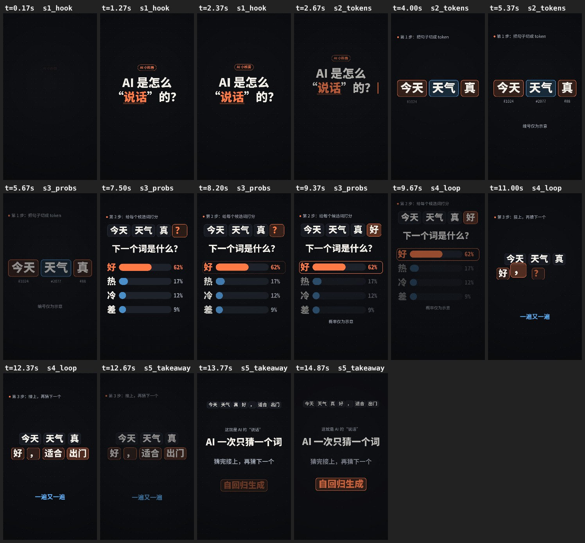
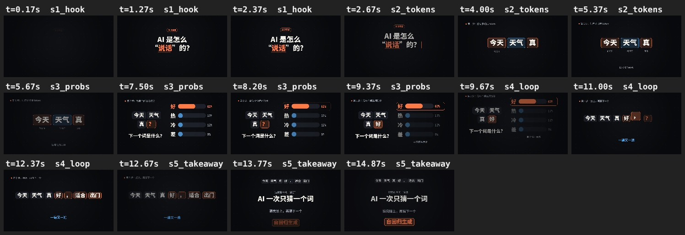

<div align="center">

# AI Video Skills

**让 AI Agent「用代码拍视频」的工具包**

分镜 → 确定性逐帧渲染 → MP4 → 自动质检 → 审片

可被 Claude Code、Codex、Grok 等能执行代码的 Agent 复用

[效果预览](#-效果预览) · [快速开始](#-快速开始) · [做你自己的视频](#-做你自己的视频) · [质检体系](#-质检体系) · [接入-agent](#-接入-agent) · [测试结果](#-测试结果) · [常见问题](#-常见问题)

</div>

---

## 这是什么

大模型本身不输出视频文件。它能做的，是**写代码把每一帧画出来**，再用无头浏览器截帧、用 FFmpeg 合成 MP4。这种做法适合动态图形、知识科普、产品讲解、文字动效，不适合写实的真人画面。

问题是：直接让 Agent "做个视频"，结果很不稳定——文字被平台按钮挡住、字还没读完就切走、转场出现空帧、每次渲染结果不一样、素材版权说不清。

这个工具包把一次性的"提示词魔法"变成**可复用、可检查的生产流程**：

| 环节 | 工具包提供什么 |
|---|---|
| 策划 | 分镜 JSON 格式：每个镜头的时间、事件、屏幕文字、**观众需要依次看懂的信息点（reads）** |
| 制作 | 确定性渲染引擎：每一帧只由时间 t 决定，可并行、可续渲、可复现；5 个可直接用参数驱动的场景组件 |
| 配乐 | 程序化合成的原创配乐和音效，自动响度归一到 -14 LUFS，**没有版权问题** |
| 质检 | 25 项自动检查（安全区、阅读时间、字号、重叠、黑帧、冻帧、响度、确定性……）+ 5 项人工审片 |
| 复用 | 4 个 Skill，按 Agent Skills 通用格式编写，一条命令装到 Claude Code / Codex / Grok |
| 评测 | 7 个跨 Agent 对照测试任务、自动评分器、评分校准 |

方法论来自对 [joeseesun/opus-video-prompts](https://github.com/joeseesun/opus-video-prompts) 收录的 Claude Opus 5.5 视频案例的调研（[`docs/research.md`](docs/research.md)）。**本仓库不包含任何第三方提示词原文或无许可代码**，所有参考来源与许可分类见 [`SOURCES.md`](SOURCES.md)。

---

## 🎬 效果预览

仓库自带一个完整案例：15 秒 AI 科普《AI 是怎么"说话"的？》，讲清楚"切成 token → 给候选词打分 → 接上再猜"。

**竖屏 9:16（抖音 / 小红书 / 视频号）** · 成片：[`ai-explainer-15s.mp4`](examples/ai-explainer-15s/results/ai-explainer-15s.mp4)



**横屏 16:9（B 站 / YouTube）** · 成片：[`ai-explainer-landscape.mp4`](examples/ai-explainer-landscape/results/ai-explainer-landscape.mp4)



两条成片的质检报告：[竖屏](examples/ai-explainer-15s/results/qa_report.md) · [横屏](examples/ai-explainer-landscape/results/qa_report.md)（均为 PASS）。

> 上面的图叫**联系表**：每个镜头的开头、中间、结尾各截一帧拼在一起。它是审片的第一步——不用看完整个视频，就能检查每个镜头有没有讲清楚、文字有没有出界。

---

## 🚀 快速开始

### 1. 准备环境

| 依赖 | 版本 | 用途 |
|---|---|---|
| Node.js | ≥ 18 | 运行渲染脚本 |
| Chromium / Chrome | 任意近期版本 | 无头浏览器逐帧绘制 |
| FFmpeg | 需带 libx264 | 合成 MP4、检测黑帧/冻帧/响度 |
| Python | ≥ 3.9，带 `numpy` `jsonschema` `pillow` | 校验、配乐合成、质检报告 |
| 中文字体 | Noto Sans CJK / 思源黑体 / 苹方 / 微软雅黑 任一 | 中文显示（缺字体时会显示成方块） |

<details>
<summary><b>macOS 安装命令</b></summary>

```bash
brew install node ffmpeg python
pip3 install numpy jsonschema pillow
# Chrome 已安装即可；或：npx playwright install chromium
```
苹方字体系统自带。
</details>

<details>
<summary><b>Ubuntu / Debian 安装命令</b></summary>

```bash
sudo apt install -y nodejs npm ffmpeg python3-pip fonts-noto-cjk
pip3 install numpy jsonschema pillow
npx playwright install chromium
```
</details>

<details>
<summary><b>Windows</b></summary>

建议在 WSL2（Ubuntu）里按上面的 Ubuntu 步骤操作（Windows 环境本仓库尚未实测）。原生 Windows 也可以尝试：安装 Node、Python、Chrome，FFmpeg 从 gyan.dev 下载并加入 PATH，再用 Git Bash 运行 `.sh` 脚本。
</details>

### 2. 克隆并自检

```bash
git clone https://github.com/huaxialucaicaizi/opus5.5-video-skills-.git ai-video-skills
cd ai-video-skills
bash scripts/setup.sh        # 安装 playwright-core，逐项检查依赖，缺什么会告诉你
```

### 3. 出第一条片

```bash
bash scripts/render/build.sh examples/ai-explainer-15s
```

大约 45 秒后（2 核 CPU、无 GPU 实测），会得到：

```
examples/ai-explainer-15s/out/
├── ai-explainer-15s.mp4     成片：1080×1920 · 30fps · 15s · H.264 + AAC · -14 LUFS
├── contact_sheet.jpg        联系表
├── keyframes/               关键帧全分辨率 PNG（审片用）
├── qa_report.md             质检报告（人能读）
└── qa_report.json           质检报告（机器能读）
```

`build.sh` 依次做了 7 步：校验分镜 → 出联系表 → 出关键帧并检查版式 → 合成配乐 → 逐帧渲染并编码 → 确定性检查 → 生成质检报告。任何一步出现阻断级问题就停下，并说明原因。

### 4. 跑一遍完整自测（可选）

```bash
bash scripts/validate/run_tests.sh           # 8 项，含整片渲染，约 2 分钟
bash scripts/validate/run_tests.sh --quick   # 跳过整片渲染
```

---

## ✍️ 做你自己的视频

### 方式 A：交给 Agent（推荐）

先把 Skill 装给你用的 Agent（详见[接入 Agent](#-接入-agent)）：

```bash
bash scripts/install-skills.sh --agent=claude    # 或 codex / grok
```

然后在 Agent 里直接说需求，例如：

```text
用 video-planner 做一条 15 秒竖屏中文科普：为什么 AI 会"一本正经地胡说八道"。
先给我看分镜，我确认后再渲染。
```

Agent 会按四个 Skill 的流程走：

```
video-planner          → 写 task.json + storyboard.json，校验通过后给你看分镜表
      ↓ 你确认
code-video-builder     → 选用/新建组件，看联系表和接缝自检，渲染 MP4
      ↓
video-quality-reviewer → 跑全部自动检查，看关键帧逐项判定，写审片意见和修改清单
      ↓ 有问题就回到 builder
交付：MP4 + 质检报告
```

有已经拍好的素材要剪辑（裁切、拼接、画中画、加字幕），用 `footage-editing`：

```text
把 talk.mp4 的口播缩成右下角圆形画中画，主画面用 broll.mp4，保留原声，字幕用 subs.srt 做成可开关的字幕轨。
```

### 方式 B：手动

1. **建项目目录**，复制示例当起点：
   ```bash
   cp -r examples/ai-explainer-15s projects/my-video
   rm -rf projects/my-video/out projects/my-video/results projects/my-video/review.json
   ```
2. **改 `task.json`**：主题、目标、受众、时长、画幅。所有外部素材都要登记作者和许可。
3. **改 `storyboard.json`**：每个场景选一个组件、填参数、写屏幕文字和 reads（格式见下节）。
4. **先校验，再看图**：
   ```bash
   python3 scripts/validate/validate_spec.py projects/my-video
   node scripts/render/render.mjs --project=projects/my-video --sheet   # 打开 out/contact_sheet.jpg 看
   ```
5. **出片**：`bash scripts/render/build.sh projects/my-video`
6. **审片**：看联系表和关键帧，把结论写进 `review.json`，再运行 `python3 scripts/validate/qa_report.py projects/my-video`。

想边改边看：在仓库根目录运行 `python3 -m http.server 8000`，浏览器打开
`http://localhost:8000/components/html-canvas/player.html?project=projects/my-video`，可以拖动进度条预览。

### 分镜格式

分镜不是给人看的文档，而是**渲染器直接读取的数据**，所以计划和成片不会走样。一个场景长这样（节选）：

```json
{
  "id": "s3_probs",
  "start": 5.5, "end": 9.5,
  "purpose": "机制：给候选词打分",
  "event": "四根概率条依次长出，「好」胜出被框住，问号槽被填上「好」",
  "component": "prob-bars",
  "params": {
    "caption": "第 2 步：给每个候选词打分",
    "context": ["今天", "天气", "真"],
    "question": "下一个词是什么？",
    "options": [{"label": "好", "p": 0.62}, {"label": "热", "p": 0.17}, {"label": "冷", "p": 0.12}, {"label": "差", "p": 0.09}],
    "pick": 0,
    "note": "概率仅为示意"
  },
  "on_screen_text": [{"text": "下一个词是什么？", "start": 5.95, "end": 9.5, "role": "headline"}],
  "reads": [
    {"start": 5.6, "end": 6.4, "what": "问题：接下来该接哪个词"},
    {"start": 6.4, "end": 8.0, "what": "每个候选词都有一个概率"},
    {"start": 8.1, "end": 9.4, "what": "概率最高的「好」被选中"}
  ],
  "transition_in": {"type": "fade", "duration": 0.4}
}
```

几个关键字段：

| 字段 | 作用 | 校验规则 |
|---|---|---|
| `event` | 这个镜头从第一帧到最后一帧**发生了什么变化** | 必填；"站着展示"不算事件 |
| `reads` | 观众必须**依次**看懂的信息点 | 每条 ≥ 0.6 秒，同一镜头内不能重叠 |
| `on_screen_text` | 屏幕文字及其出现时间 | 停留时间 ≥ 字数 ÷ 6 字/秒（至少 0.8 秒） |
| `component` + `params` | 用哪个组件、怎么画 | 组件必须已注册 |
| `transition_in` | 怎么进入这个镜头 | 每个接缝都要有转场，开头和结尾也要 |
| `reserved_regions` | （全片级）后期要叠画中画等元素的区域 | 文字不能进入这些区域 |

完整定义：[`templates/storyboard/storyboard.schema.json`](templates/storyboard/storyboard.schema.json)、[`spec/video-task.schema.json`](spec/video-task.schema.json)。

### 现有组件

| 组件 | 画面 | 典型用途 |
|---|---|---|
| `kinetic-title` | 标签 + 多行标题遮罩上升 + 关键词下划线 + 光标 | 开场提问、章节标题 |
| `token-split` | 一句话裂成若干块，下方出现编号 | 拆解概念、分步骤 |
| `prob-bars` | 上下文 + 问题 + 横向概率条，选中最高项（横屏自动左右分栏） | 对比、打分、排名 |
| `append-loop` | 一行方块不断追加，每步先出问号再落下 | 迭代、循环、逐步生成 |
| `takeaway` | 回顾行 + 结论 + 副句 + 术语徽章 | 结尾总结 |

参数说明和"如何写新组件"见 [`components/html-canvas/README.md`](components/html-canvas/README.md)。测评中 Agent 已经自己写出过流程图（`flow-diagram`）、事实核查（`fact-check`）等组件——现有组件不够时，让 Agent 按规则新建即可。

### 视觉风格

| 文件 | 画幅 | 安全区（文字不能进入平台 UI 区域） |
|---|---|---|
| [`style.default.json`](templates/visual-style/style.default.json) | 9:16 竖屏 | 上 220 / 下 360 / 左右 72（px，按 1080 宽） |
| [`style.landscape.json`](templates/visual-style/style.landscape.json) | 16:9 横屏 | 上 90 / 下 110 / 左右 140（px，按 1920 宽） |

风格文件里定义了色板、字号阶梯、动效参数、阅读速度和**禁用清单**（粒子爆炸、镜头光晕、霓虹辉光、弹跳缓动……这些是"模板味"的主要来源）。换品牌风格：复制一份改值即可，键名不要改。设计原则见 [`VISUAL_GUIDE.md`](templates/visual-style/VISUAL_GUIDE.md)。

---

## 🔍 质检体系

完整清单：[`spec/ACCEPTANCE_CHECKLIST.md`](spec/ACCEPTANCE_CHECKLIST.md)。P0 级任何一项失败都不能交付。

| 类别 | 检查项 | 怎么查的 |
|---|---|---|
| 分镜 | 结构、场景首尾相接、reads、阅读速度、卡点、转场、组件已注册、风格适配画幅 | 渲染前静态检查（`validate_spec.py`） |
| 版式 | 安全区、最小字号、文字重叠、保留区域、文字溢出方框 | **用实际渲染出来的文字位置判断**，包括镜头推近后的位置（`layout_check.py`） |
| 成片 | 时长、分辨率、帧率、编码、faststart、黑帧、冻帧、响度 | 直接分析 MP4（`probe_video.py`） |
| 确定性 | 同一时刻渲染两次像素完全一致 | 两个页面、打乱顺序、重复渲染后比对哈希（`check_determinism.mjs`） |
| 素材 | 每个外部文件都有作者和许可，许可不能是 unknown | 读 `task.json` |
| 人工 | 信息正确、每镜有事件、焦点清晰、风格一致、首尾呼应 | 审片者看联系表、接缝帧条、关键帧后填写 |

报告结论分四档：`PASS` / `PASS_WITH_WARNINGS` / `NEEDS_REVIEW`（人工项没审）/ `FAIL`。**没有看过图，就不能给 PASS。**

这套检查在开发中实际抓到过：文字停留 0.9 秒不够读、标签在镜头推近后越出安全区 2 像素、两个镜头之间约 0.25 秒的空帧、字幕被画中画挡住等。修复记录见 [`docs/PLAN.md`](docs/PLAN.md)。

---

## 🤖 接入 Agent

不同 Agent 的 Skill 加载机制、指令文件和工具权限都不一样。四个 SKILL.md 本身与 Agent 无关，差异集中在安装脚本里处理。

| | Claude Code | Codex CLI | Grok Build | Grok（API / 对话） |
|---|---|---|---|---|
| 安装 | `install-skills.sh --agent=claude` | `install-skills.sh --agent=codex` | `install-skills.sh --agent=grok` | 粘贴 [`adapters/grok/PROMPT.md`](adapters/grok/PROMPT.md) |
| Skill 位置 | `.claude/skills/` | `.agents/skills/` | `.grok/skills/` | — |
| 指令文件 | `CLAUDE.md` | `AGENTS.md` | 待确认 | 首条消息 |
| 调用 | `/video-planner` 或自动 | `$video-planner` 或自动 | 版本相关 | "先读 skills/…/SKILL.md" |
| 本仓库实测 | ✅ 已验证 | ⚠️ 未实测 | ⚠️ 未实测 | ⚠️ 未实测 |

装到你自己的其他项目里：

```bash
bash scripts/install-skills.sh --agent=claude --target=~/my-project --mode=copy
```

详细说明（含权限建议、沙箱限制、各 Agent 的已知差异）：[`docs/AGENT_INTEGRATION.md`](docs/AGENT_INTEGRATION.md)。

> **关于 API Key**：如果接 TTS 等外部服务，把 key 放在 `.env` 里，并禁止 Agent 读取（Claude Code 可用 [`adapters/claude-code/settings.example.json`](adapters/claude-code/settings.example.json) 里的 `deny` 规则）。

---

## 📊 测试结果

开发环境：2 核 CPU、7 GB 内存、无 GPU。完整数据见 [`docs/TEST_RESULTS.md`](docs/TEST_RESULTS.md)。

**出片**

| 项目 | 规格 | 一键构建 | 质检 |
|---|---|---|---|
| 竖屏示例 | 1080×1920 · 30fps · 15s | ≈ 45 秒 | PASS（自动 24 通过 / 1 跳过，人工 5/5） |
| 横屏示例 | 1920×1080 · 30fps · 15s | ≈ 43 秒 | PASS |

**跨模型对照**（Claude Code 无头模式，同一版本工具包，共 18 次运行）

| | Haiku 5.5 | Sonnet 5.5 | Opus 5.5 |
|---|---|---|---|
| 自动评分 | 全部满分（E5 为 96，即标准答案上限） | 同左 | 同左（跑了 3 个任务） |
| 做一条 15 秒科普 | ≈ 5–7 分钟 · ≈ $0.3 | ≈ 3–4 分钟 · ≈ $0.5 | ≈ 6–7 分钟 · ≈ $1.8 |
| 成片质量（人工看图） | 能用，偶有生硬断行 | 稳定 | 最好：会主动新建组件，把"核实"直接画出来 |

**选模型建议**：日常更新用 Sonnet，重点内容用 Opus。各模型的成片截图对比见 [`evals/cross-agent/results/visual/`](evals/cross-agent/results/visual/)。

自动评分全部满分，说明当前测评任务**区分不出模型高低**。这是已知局限，下一步会加难度并加入人工盲评（[`evals/cross-agent/rubric.md`](evals/cross-agent/rubric.md)）。自己跑测评的方法见 [`evals/cross-agent/README.md`](evals/cross-agent/README.md)。

---

## 📁 项目结构

```
skills/                          四个 Skill（Agent Skills 通用格式）
  video-planner/                 需求 → task.json + storyboard.json，校验后请求确认
  code-video-builder/            storyboard → 确定性场景代码 → 联系表/接缝自检 → MP4
  video-quality-reviewer/        自动检查 + 看关键帧 → 审片意见 + 质检报告 + 修改清单
  footage-editing/               已有素材：裁切 / 拼接 / 画中画 / 字幕轨 / 混音 / 响度
spec/                            任务 Schema · 验收清单
templates/storyboard/            分镜 Schema
templates/visual-style/          竖屏 / 横屏风格 · 视觉设计规范
components/html-canvas/          渲染引擎 · 浏览器播放器 · 场景组件
components/remotion/             Remotion 包装层（复用同一套引擎和组件）
scripts/setup.sh                 环境检查与依赖安装
scripts/install-skills.sh        把 Skill 装给指定 Agent
scripts/render/                  render.mjs（渲染）· build.sh（一键出片）· synth_music.py（配乐）· footage.py（剪辑）
scripts/validate/                各项校验 · 质检报告 · 自测
examples/                        竖屏、横屏两个完整案例（含成片与报告）
evals/cross-agent/               跨 Agent 测评：任务、夹具、评分器、校准、运行记录
adapters/                        Claude Code 权限示例 · Grok 粘贴版提示词
docs/                            调研 · 实施记录 · 测试结果 · Agent 接入说明
AGENTS.md / CLAUDE.md            给 Agent 的总说明
```

### 常用命令

| 想做什么 | 命令 |
|---|---|
| 一键出片 | `bash scripts/render/build.sh <项目目录>` |
| 只出联系表（最快的检查方式） | `node scripts/render/render.mjs --project=<项目目录> --sheet` |
| 看某几个时刻 | `node scripts/render/render.mjs --project=<项目目录> --sheet=2.4,2.5,2.6 --cols=3` |
| 只校验分镜 | `python3 scripts/validate/validate_spec.py <项目目录>` |
| 检查一个现成 MP4 | `python3 scripts/validate/probe_video.py <文件.mp4>` |
| 开运动模糊（渲染慢约 3 倍） | `bash scripts/render/build.sh <项目目录> --blur=3` |
| 剪辑素材 | `python3 scripts/render/footage.py --help` |

---

## ❓ 常见问题

**中文显示成方块？**
系统没有中文字体。macOS 自带苹方；Linux 装 `fonts-noto-cjk`；也可以在风格文件的 `font_stack` 里写上你已安装的字体名。

**`player failed to boot` 报错？**
看后面的报错信息。最常见：分镜里的 `style` 路径写错了（必须是相对路径，且在仓库目录内）、引用了没注册的组件、组件代码有语法错误。

**确定性检查（T4）失败？**
组件里用了 `Math.random()`、`Date.now()`、计时器，或者在帧与帧之间保存了状态。改用 `hash()` 生成稳定随机数，所有运动都写成时间 t 的函数。

**渲染太慢？**
先只出联系表检查，没问题再出整片；`--workers` 设成 CPU 核数；草稿阶段不要开运动模糊。

**能做写实的真人视频吗？**
不能。代码渲染适合动态图形、图解、文字动效。写实画面需要外部视频模型，可以用 `footage-editing` 把它们和代码动画合成在一起，素材需登记许可。

**可以用 Remotion 吗？**
可以，见 [`components/remotion/`](components/remotion/README.md)。它复用同一套组件，画面与 HTML 版逐像素一致。注意：Remotion 对超过 3 人的营利公司收费；另外本仓库**尚未在真实 Remotion 中实测**。

**`npm install` 失败？**
`setup.sh` 会尝试链接本机已有的 `playwright-core`。仍不行请检查网络或 npm 镜像设置。

---

## 🗺️ 路线图

- [ ] 在 Codex、Grok 上实测并补充接入细节
- [ ] 在真实 Remotion 中验证 `npm run render`
- [ ] TTS 旁白 + 字幕驱动的时间轴
- [ ] 更多组件：流程图、对比卡、时间线、数据图表
- [ ] 加难度的测评任务 + 人工盲评，让评分能区分模型
- [ ] 不依赖浏览器的 Python 渲染路线，供只有托管沙箱的 Agent 使用

---

## 📄 许可

- 本仓库原创代码与文档：**MIT**（[`LICENSE`](LICENSE)）
- 示例配乐由 `synth_music.py` 程序化生成，随本仓库许可
- Remotion 为可选依赖，适用其自身许可
- 参考来源与许可分类：[`SOURCES.md`](SOURCES.md)。调研中参考的提示词版权归原作者，本仓库只记录作者和链接，不转载原文

## 致谢

方法论受以下公开案例与项目启发（仅参考，未复制内容）：[opus-video-prompts](https://github.com/joeseesun/opus-video-prompts)（向阳乔木整理）、[ClaudeAnimationBase](https://github.com/JohnHeibel/ClaudeAnimationBase)（John Heibel）、[PDoomVideo](https://github.com/JohnHeibel/PDoomVideo)、[Battle-of-Austerlitz-Film](https://github.com/WinterArc21/Battle-of-Austerlitz-Film)，以及 zero (@twoclipping)、Danny Stuart、WY (@akokoi1)、Axton (@AxtonLiu) 等作者公开分享的制作经验。
